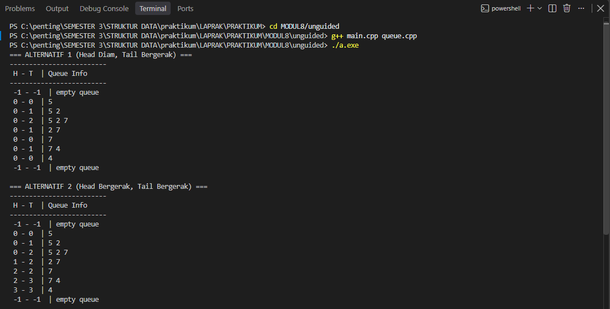
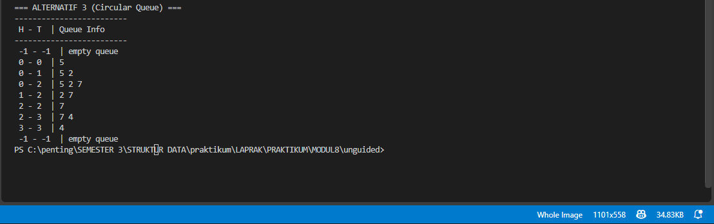

# <h1 align="center">Laporan Praktikum Modul 8 - QUEUE</h1>

<p align="center">Farel Juliyandra Restu Hermawan - 109082530038</p>

## Dasar Teori

Queue (antrean) adalah salah satu bentuk struktur data linear yang menerapkan prinsip seperti antrean pada dunia nyata, di mana elemen yang pertama kali masuk ke dalam antrean akan menjadi elemen pertama yang diambil atau dikeluarkan terlebih dahulu. Prinsip operasi ini dikenal sebagai FIFO (First In First Out). Berbeda dengan linked list biasa yang memungkinkan akses di berbagai posisi, akses data pada queue hanya dapat dilakukan pada dua ujung saja: proses penyisipan (Enqueue) selalu dilakukan pada bagian belakang yang disebut Tail, sedangkan proses pengambilan atau penghapusan (Dequeue) selalu dilakukan pada bagian depan yang disebut Head.

Implementasi struktur data queue dapat dilakukan menggunakan dua pendekatan:
1. Representasi Pointer: Menggunakan linked list dinamis (Singly Linked List maupun Doubly Linked List) di mana setiap elemen saling terhubung melalui pointer next, serta memiliki komponen utama head dan tail yang menunjuk pada elemen terdepan dan elemen paling belakang.
2. Representasi Tabel: Menggunakan array berindeks dengan kapasitas maksimum tertentu (Imax atau MAX) dan penanda indeks head serta tail untuk melacak posisi elemen terdepan dan terbelakang. Dalam penerapannya terdapat tiga mekanisme pengelolaan indeks, yaitu Alternatif 1 (head diam, tail bergerak), Alternatif 2 (head bergerak, tail bergerak), serta Alternatif 3 (head dan tail berputar/circular queue).

Operasi-operasi dalam Queue:
1. CreateQueue: Menginisialisasi queue baru dalam kondisi kosong.
2. IsEmpty dan IsFull: Memeriksa apakah queue dalam keadaan kosong atau sudah penuh (khusus representasi tabel).
3. Enqueue: Operasi menyisipkan atau menambahkan elemen baru pada posisi paling belakang (Tail).
4. Dequeue: Operasi mengambil sekaligus menghapus elemen yang berada pada posisi paling depan (Head).
5. ViewQueue, PrintInfo, dan ClearQueue: Operasi tambahan untuk menampilkan seluruh isi queue serta menghapus seluruh elemen di dalam queue.

## Guided

1. ### Implementasi ADT Queue Menggunakan Array (Representasi Tabel)
### A. File Header (queueArray.h)

```C++
#ifndef QUEUE_H
#define QUEUE_H

#include <iostream>
using namespace std;

const int MAKSIMAL = 5;

struct queue {
    string nama[MAKSIMAL];
    int head;
    int tail;
};

bool isFull(queue Q);
bool isEmpty(queue Q);
void CreateQueue(queue &Q);
void enQueue(queue &Q, string nama);
void deQueue(queue &Q);
void viewQueue(queue Q);

#endif
```
File header ini berfungsi sebagai spesifikasi tipe data dan prototipe fungsi/prosedur untuk ADT Queue berbasis array statis dengan kapasitas maksimum MAKSIMAL = 5. Di dalamnya dideklarasikan struct queue yang memiliki array nama[MAKSIMAL] bertipe string dan penanda indeks head serta tail, beserta fungsi validator (isFull, isEmpty), konstruktor (CreateQueue), dan prosedur manipulasi data (enQueue, deQueue, viewQueue).

### B. File Implementasi (queueArray.cpp)

```C++
#include "queueArray.h"
#include <iostream>

using namespace std;

// NOTE : 
// Implementasi 1 = head diam, tail bergerak (Queue Linear Statis, kerana head nya tetap diam)
// Implementasi 2 = head bergerak, tail bergerak (Queue Linear Dinamis, karena head & tail nya sama-sama bergerak)
// Implementasi 3 = head dan tail berputar (Queue Circular, karena jika udh mentok tapi masih ada space, diputar sehingga tail bisa ada didepan head)

bool isEmpty(queue Q){
    if(Q.head == -1 && Q.tail == -1){
        return true;
    } else {
        return false;
    }
}

//isFull implmenetasi 1 & 2
bool isFull(queue Q){
    if(Q.tail == MAKSIMAL - 1){
        return true;
    } else {
        return false;
    }
}

// //isFull implementasi 3
// bool isFull(queue Q){
//     if((Q.tail + 1) % MAKSIMAL == Q.head){
//         return true;
//     } else {
//         return false;
//     }
// }

void CreateQueue(queue &Q){ //terbentuk queue dengan head = -1 dan tail = -1 
    Q.head = -1;
    Q.tail = -1;
}
 

//enqueue implementasi 1 & 2
void enQueue(queue &Q, string nama){
    if(isFull(Q) == true){
        cout << "Queue sudah penuh!" << endl;
    } else {
        if(isEmpty(Q) == true){
            Q.head = Q.tail = 0;
        } else {
            Q.tail++;
        }
        Q.nama[Q.tail] = nama;
        cout << "nama " << nama << " berhasil ditambahkan kedalam queue!" << endl;
    }
}

// //enQueue implementasi 3
// void enQueue(queue &Q, string nama){
//     if(isFull(Q) == true){
//         cout << "Queue sudah penuh!" << endl;
//     } else {
//         if(isEmpty(Q) == true){
//             Q.head = Q.tail = 0;
//         } else {
//             Q.tail = (Q.tail + 1) % MAKSIMAL; // bergerak melingkar
//         }
//         Q.nama[Q.tail] = nama;
//         cout << "nama " << nama << " berhasil ditambahkan kedalam queue!" << endl;
//     }
// }

//dequeue implementasi 1
void deQueue(queue &Q){
    if(isEmpty(Q) == true){
        cout << "Queue kosong!" << endl;
    } else {
        cout << "Mengahapus data " << Q.nama[Q.head] << "..." << endl;
        for(int i = 0; i < Q.tail; i++){
            Q.nama[i] =  Q.nama[i+1];
        }
        Q.tail--;
        if(Q.tail < 0){ //kalo semua isi queue nya udh dikeluarin, set head & tail ke -1
            Q.head = -1;
            Q.tail = -1;
        }
    }
}

// //dequeue implementasi 2
// void deQueue(queue &Q){
//     if(isEmpty(Q) == true){
//         cout << "Queue kosong!" << endl;
//     } else {
//         cout << "Mengahapus data " << Q.nama[Q.head] << "..." << endl;
//         Q.head++;
//         if(Q.head > Q.tail){ //kalo elemennya udh abis (head akan lebih 1 dari tail), maka reset ulang head & tail ke -1
//             Q.head = -1;
//             Q.tail = -1;
//         }
//     }
// }

// //deQueue implementasi 3
// void deQueue(queue &Q){
//     if(isEmpty(Q) == true){
//         cout << "Queue kosong!" << endl;
//     } else {
//         cout << "Mengahapus data " << Q.nama[Q.head] << "..." << endl;
//         if(Q.head == Q.tail){ //kalo elemennya tinggal 1, langsungkan saja head & tail nya reset ke -1
//             Q.head = -1;
//             Q.tail = -1;
//         } else {
//             Q.head = (Q.head + 1) % MAKSIMAL; // bergerak melingkar
//         }
//     }
// }

//viewQueue implementasi 1 & 2
void viewQueue(queue Q){
    if(isEmpty(Q) == true){
        cout << "Queue kosong!" << endl;
    } else {
        for(int i = Q.head; i <= Q.tail; i++){
            cout << i -  Q.head + 1 << ". " << Q.nama[i] << endl;
        }
    }
    cout << endl;
}

// //viewQueue implementasi 3
// void viewQueue(queue Q){
//     if(isEmpty(Q) == true){
//         cout << "Queue kosong!" << endl;
//     } else {
//         int i = Q.head;
//         int count = 1;
//         while(true){
//             cout << count << ". " << Q.nama[i] << endl;
//             if(i == Q.tail){
//                 break;
//             }
//             i = (i + 1) % MAKSIMAL;
//             count++;
//         }   
//     }
// }
```
File implementasi ini merealisasikan seluruh operasi queue dengan representasi tabel menggunakan mekanisme Implementasi 1 (head diam, tail bergerak). Queue kosong ditandai dengan nilai Q.head = -1 dan Q.tail = -1. Operasi enQueue memajukan indeks tail sebelum menyimpan data baru, sedangkan deQueue mengambil data pada indeks head lalu menggeser seluruh elemen sisa ke kiri dan menurunkan nilai tail. Prosedur viewQueue menelusuri array dari indeks Q.head menuju indeks Q.tail.

### C. File Driver (mainArray.cpp)

```C++
#include "queueArray.h"
#include <iostream>

using namespace std;

int main(){
    queue Q;

    CreateQueue(Q);
    enQueue(Q, "Dimas");
    enQueue(Q, "Arvin");
    enQueue(Q, "Rizal");
    enQueue(Q, "Hafizh");
    enQueue(Q, "Fathur");
    enQueue(Q, "Daffa");
    cout << endl;

    cout << "--- Isi Queue Setelah enQueue ---" << endl;
    viewQueue(Q);
    cout << endl;

    deQueue(Q);
    deQueue(Q);
    deQueue(Q);
    deQueue(Q);
    // deQueue(Q);
    // deQueue(Q);
    cout << endl;

    cout << "--- Isi Queue Setelah deQueue ---" << endl;
    viewQueue(Q);

    return 0;
}
```
File driver utama Guided 1 menguji alur pembuatan queue berbasis array, penyisipan enam elemen nama (di mana elemen ke-6 akan ditolak karena kapasitas maksimum array adalah 5), pencetakan isi antrean, serta penghapusan empat elemen terdepan menggunakan deQueue.

Penjelasan Keseluruhan Program Guided 1 :
Program ini mendemonstrasikan implementasi Struktur Data Abstrak (ADT) Queue menggunakan representasi array (tabel) berkapasitas tetap di C++. Seluruh proses penambahan, pengambilan, dan penampilan data dikendalikan melalui pergeseran indeks tail serta pergeseran elemen array tanpa memerlukan manajemen memori dinamis.

2. ### Implementasi ADT Queue Menggunakan Pointer (Linked List)
### A. File Header (queueSLL.h)

```C++
#ifndef QUEUE_H
#define QUEUE_H

#include <iostream>
#include <string>
using namespace std;

struct Node{
    string nama;
    Node *next;
};

struct queue{
    Node *head, *tail;
};

void createQueue(queue &Q);
bool isEmpty(queue Q);
bool isFull(queue Q);
void enqueue(queue &Q, const string &nama);
void dequeue(queue &Q);
void viewQueue(queue Q);
void clearQueue(queue &Q);
#endif
```
File header ini mendefinisikan ADT Queue dengan representasi pointer dinamis. Di dalamnya dideklarasikan struktur simpul Node yang menyimpan nama dan pointer next, serta struktur queue yang memiliki pointer head dan tail untuk menunjuk elemen terdepan dan terbelakang.

### B. File Implementasi (queueSLL.cpp)

```C++
#include "queueSLL.h"

void createQueue(queue &Q)
{
    Q.head = Q.tail = nullptr;
}

bool isEmpty(queue Q)
{
    return Q.head == nullptr && Q.tail == nullptr;
}

bool isFull(queue Q)
{
    int maxQueue = 20;
    int counter = 0;
    Node *nodeBantu = Q.head;

    while (nodeBantu != Q.tail)
    {
        counter++;
        nodeBantu -> next;
    }

    return counter >= maxQueue;
}

void enqueue(queue &Q, const string &nama)
{
    if (isEmpty(Q)) 
    {
        Node *nodeBaru = new Node{nama, nullptr};
        Q.head = Q.tail = nodeBaru;
    } 
    else 
    {
        Node *nodeBaru = new Node{nama, nullptr};
        Q.tail -> next = nodeBaru;
        Q.tail = nodeBaru;
    }
}

void dequeue(queue &Q)
{
    if (isEmpty(Q)) 
    {
        cout << "Queue kosong";
    }
    else
    {
        Node *nodeHapus = Q.head;
        Q.head = Q.head -> next;
        delete nodeHapus;
    }
}

void viewQueue(queue Q)
{
    if (isEmpty(Q))
    {
        cout << "Queue kosong";
    }
    else
    {
        Node *nodeBantu = Q.head;

        while (nodeBantu != nullptr)
        {
            cout << "Nama : " << nodeBantu -> nama << endl;
            nodeBantu = nodeBantu -> next;
        }
    }
}

void clearQueue(queue &Q)
{
    if (isEmpty(Q))
    {
        cout << "Queue kosong";
    }
    else
    {
        Node *nodeHapus = Q.head;

        while (nodeHapus != nullptr)
        {
            nodeHapus = nodeHapus -> next;
            dequeue(Q);
        }
    }
}
```
File implementasi ini merealisasikan operasi queue berbasis pointer beserta manajemen memori dinamis (new dan delete). Operasi enqueue bekerja seperti insert last dengan menyambungkan nodeBaru ke Q.tail->next lalu memindahkan Q.tail ke nodeBaru, sedangkan dequeue bekerja seperti delete first dengan memindahkan pointer Q.head ke simpul berikutnya dan menghapus simpul terdepan dari memori.

### C. File Driver (mainSLL.cpp)

```C++
#include "queueSLL.h"
#include <iostream>
using namespace std;

int main (){
    queue Q;
    createQueue(Q);

    enqueue(Q, "Dominic");
    enqueue(Q, "Torr");
    enqueue(Q, "Retto");
    enqueue(Q, "Letty");
    enqueue(Q, "Brian");
    enqueue(Q, "Mia");
    cout << "---Isi Queue sebelum di dequeue:---"<< endl;
    viewQueue(Q);

    cout << "---Isi Queue setelah di dequeue: ---"<< endl;
    dequeue(Q);
    dequeue(Q);
    dequeue(Q);
    dequeue(Q);
    cout << "Isi Queue setelah di dequeue: " << endl;
    viewQueue(Q);
    return 0;
}
```
File driver utama Guided 2 menguji alokasi simpul dinamis, penyisipan enam simpul nama ke dalam queue, pencetakan elemen dari head ke tail, serta penghapusan empat simpul terdepan.

Penjelasan Keseluruhan Program Guided 2 :
Program ini mendemonstrasikan implementasi ADT Queue menggunakan representasi pointer dinamis (Singly Linked List) di C++. Berbeda dengan representasi array yang kapasitasnya terbatas, pendekatan pointer memungkinkan ukuran antrean bertambah secara dinamis selama memori tersedia tanpa memerlukan pergeseran elemen, dengan memanfaatkan prinsip insert last untuk enqueue dan delete first untuk dequeue.

## Unguided

1. ### Implementasi ADT Queue Menggunakan Array (Alternatif 1, 2, dan 3)
### A. File Header (queue.h)

```C++
#ifndef QUEUE_H
#define QUEUE_H

#include <iostream>
using namespace std;

const int MAX = 5;
typedef int infotype;

struct Queue {
    infotype info[MAX];
    int head;
    int tail;
};

void createQueue(Queue &Q);
bool isEmptyQueue(Queue Q);

// Alternatif 1 (head diam, tail bergerak)
bool isFullQueue1(Queue Q);
void enqueue1(Queue &Q, infotype x);
infotype dequeue1(Queue &Q);
void printInfo1(Queue Q);

// Alternatif 2 (head bergerak, tail bergerak)
bool isFullQueue2(Queue Q);
void enqueue2(Queue &Q, infotype x);
infotype dequeue2(Queue &Q);
void printInfo2(Queue Q);

// Alternatif 3 (head dan tail berputar / Circular Queue)
bool isFullQueue3(Queue Q);
void enqueue3(Queue &Q, infotype x);
infotype dequeue3(Queue &Q);
void printInfo3(Queue Q);

#endif
```
File header ini mendefinisikan ADT Queue menggunakan array berkapasitas 5 elemen bertipe infotype (integer) sesuai spesifikasi latihan modul 8. Selain konstruktor createQueue dan validator isEmptyQueue, seluruh fungsi dan prosedur untuk ketiga mekanisme pengelolaan indeks antrean (Alternatif 1, Alternatif 2, dan Alternatif 3) disatukan dalam satu file header dengan penamaan fungsi yang dibedakan agar dapat dikompilasi dan diuji secara bersamaan.

### B. File Implementasi (queue.cpp)

```C++
#include "queue.h"

void createQueue(Queue &Q) {
    Q.head = -1;
    Q.tail = -1;
}

bool isEmptyQueue(Queue Q) {
    return (Q.head == -1 && Q.tail == -1);
}

// ================= ALTERNATIF 1 (head diam, tail bergerak) =================
bool isFullQueue1(Queue Q) {
    return (Q.tail == MAX - 1);
}

void enqueue1(Queue &Q, infotype x) {
    if (isFullQueue1(Q)) {
        cout << "Queue penuh!" << endl;
    } else {
        if (isEmptyQueue(Q)) {
            Q.head = 0;
            Q.tail = 0;
        } else {
            Q.tail++;
        }
        Q.info[Q.tail] = x;
    }
}

infotype dequeue1(Queue &Q) {
    infotype x = -1;
    if (isEmptyQueue(Q)) {
        cout << "Queue kosong!" << endl;
    } else {
        x = Q.info[Q.head];
        if (Q.head == Q.tail) {
            createQueue(Q);
        } else {
            for (int i = Q.head; i < Q.tail; i++) {
                Q.info[i] = Q.info[i + 1];
            }
            Q.tail--;
        }
    }
    return x;
}

void printInfo1(Queue Q) {
    cout << " " << Q.head << " - " << Q.tail << "  | ";
    if (isEmptyQueue(Q)) {
        cout << "empty queue";
    } else {
        for (int i = Q.head; i <= Q.tail; i++) {
            cout << Q.info[i] << " ";
        }
    }
    cout << endl;
}

// ================= ALTERNATIF 2 (head bergerak, tail bergerak) =================
bool isFullQueue2(Queue Q) {
    return (Q.head == 0 && Q.tail == MAX - 1);
}

void enqueue2(Queue &Q, infotype x) {
    if (isFullQueue2(Q)) {
        cout << "Queue penuh!" << endl;
    } else {
        if (isEmptyQueue(Q)) {
            Q.head = 0;
            Q.tail = 0;
        } else {
            if (Q.tail == MAX - 1) {
                int j = 0;
                for (int i = Q.head; i <= Q.tail; i++) {
                    Q.info[j] = Q.info[i];
                    j++;
                }
                Q.head = 0;
                Q.tail = j - 1;
            }
            Q.tail++;
        }
        Q.info[Q.tail] = x;
    }
}

infotype dequeue2(Queue &Q) {
    infotype x = -1;
    if (isEmptyQueue(Q)) {
        cout << "Queue kosong!" << endl;
    } else {
        x = Q.info[Q.head];
        if (Q.head == Q.tail) {
            createQueue(Q);
        } else {
            Q.head++;
        }
    }
    return x;
}

void printInfo2(Queue Q) {
    cout << " " << Q.head << " - " << Q.tail << "  | ";
    if (isEmptyQueue(Q)) {
        cout << "empty queue";
    } else {
        for (int i = Q.head; i <= Q.tail; i++) {
            cout << Q.info[i] << " ";
        }
    }
    cout << endl;
}

// ================= ALTERNATIF 3 (head dan tail berputar) =================
bool isFullQueue3(Queue Q) {
    return ((Q.tail + 1) % MAX == Q.head);
}

void enqueue3(Queue &Q, infotype x) {
    if (isFullQueue3(Q)) {
        cout << "Queue penuh!" << endl;
    } else {
        if (isEmptyQueue(Q)) {
            Q.head = 0;
            Q.tail = 0;
        } else {
            Q.tail = (Q.tail + 1) % MAX;
        }
        Q.info[Q.tail] = x;
    }
}

infotype dequeue3(Queue &Q) {
    infotype x = -1;
    if (isEmptyQueue(Q)) {
        cout << "Queue kosong!" << endl;
    } else {
        x = Q.info[Q.head];
        if (Q.head == Q.tail) {
            createQueue(Q);
        } else {
            Q.head = (Q.head + 1) % MAX;
        }
    }
    return x;
}

void printInfo3(Queue Q) {
    cout << " " << Q.head << " - " << Q.tail << "  | ";
    if (isEmptyQueue(Q)) {
        cout << "empty queue";
    } else {
        int i = Q.head;
        while (true) {
            cout << Q.info[i] << " ";
            if (i == Q.tail) break;
            i = (i + 1) % MAX;
        }
    }
    cout << endl;
}
```
File implementasi ini merealisasikan seluruh primitif dan ketiga mekanisme pengelolaan indeks antrean pada latihan modul 8 dalam satu file queue.cpp. Pada Alternatif 1, indeks head tetap berada di posisi 0 sehingga fungsi dequeue1 menggeser seluruh elemen sisa ke kiri dan menurunkan indeks tail. Pada Alternatif 2, fungsi dequeue2 cukup memajukan indeks head tanpa menggeser elemen, serta menangani kondisi penuh semu dengan menggeser elemen ke awal array pada enqueue2 apabila tail mencapai batas akhir. Pada Alternatif 3 (circular queue), pergerakan indeks head dan tail menggunakan operator modulo (% MAX) agar indeks dapat berputar kembali ke posisi awal array tanpa perlu melakukan pergeseran elemen.

### C. File Driver (main.cpp)

```C++
#include <iostream>
#include "queue.h"

using namespace std;

int main() {
    cout << "=== ALTERNATIF 1 (Head Diam, Tail Bergerak) ===" << endl;
    {
        Queue Q;
        createQueue(Q);
        cout << "-------------------------" << endl;
        cout << " H - T  | Queue Info" << endl;
        cout << "-------------------------" << endl;
        printInfo1(Q);
        enqueue1(Q, 5); printInfo1(Q);
        enqueue1(Q, 2); printInfo1(Q);
        enqueue1(Q, 7); printInfo1(Q);
        dequeue1(Q);    printInfo1(Q);
        dequeue1(Q);    printInfo1(Q);
        enqueue1(Q, 4); printInfo1(Q);
        dequeue1(Q);    printInfo1(Q);
        dequeue1(Q);    printInfo1(Q);
    }

    cout << endl;

    cout << "=== ALTERNATIF 2 (Head Bergerak, Tail Bergerak) ===" << endl;
    {
        Queue Q;
        createQueue(Q);
        cout << "-------------------------" << endl;
        cout << " H - T  | Queue Info" << endl;
        cout << "-------------------------" << endl;
        printInfo2(Q);
        enqueue2(Q, 5); printInfo2(Q);
        enqueue2(Q, 2); printInfo2(Q);
        enqueue2(Q, 7); printInfo2(Q);
        dequeue2(Q);    printInfo2(Q);
        dequeue2(Q);    printInfo2(Q);
        enqueue2(Q, 4); printInfo2(Q);
        dequeue2(Q);    printInfo2(Q);
        dequeue2(Q);    printInfo2(Q);
    }

    cout << endl;

    cout << "=== ALTERNATIF 3 (Circular Queue) ===" << endl;
    {
        Queue Q;
        createQueue(Q);
        cout << "-------------------------" << endl;
        cout << " H - T  | Queue Info" << endl;
        cout << "-------------------------" << endl;
        printInfo3(Q);
        enqueue3(Q, 5); printInfo3(Q);
        enqueue3(Q, 2); printInfo3(Q);
        enqueue3(Q, 7); printInfo3(Q);
        dequeue3(Q);    printInfo3(Q);
        dequeue3(Q);    printInfo3(Q);
        enqueue3(Q, 4); printInfo3(Q);
        dequeue3(Q);    printInfo3(Q);
        dequeue3(Q);    printInfo3(Q);
    }

    return 0;
}
```
File driver utama Unguided menguji ketiga bagian latihan modul 8 secara berurutan di dalam satu file main.cpp menggunakan blok cakupan lokal untuk masing-masing antrean. Setiap bagian menjalankan kombinasi operasi createQueue, enqueue, dequeue, dan printInfo yang sama untuk menampilkan dan membandingkan pergeseran posisi indeks head dan tail (H - T) pada Alternatif 1, Alternatif 2, dan Alternatif 3 secara langsung dalam satu kali eksekusi program.

Penjelasan Keseluruhan Program Unguided :
Program ini mengimplementasikan ADT Queue berbasis array berkapasitas 5 elemen secara modular dengan memisahkan queue.h, queue.cpp, dan main.cpp di mana ketiga alternatif mekanisme queue disatukan untuk dapat dikompilasi dan diuji sekaligus. Perbandingan langsung pada output menunjukkan bahwa mekanisme circular queue (Alternatif 3) merupakan solusi paling optimal untuk memanfaatkan ruang array secara berputar tanpa perlu melakukan pergeseran data.

### Output Unguided  :

##### Output 1



##### Output 2



## Kesimpulan

Praktikum Modul 8 mengenai Queue memberikan pemahaman mengenai pengoperasian struktur data bertipe FIFO (First In First Out) di mana seluruh akses penyisipan (enqueue) dilakukan pada ujung belakang (Tail) dan pengambilan (dequeue) dilakukan pada ujung depan (Head). Implementasi queue menggunakan representasi array (tabel) menawarkan pengelolaan indeks yang sederhana namun terbatas kapasitasnya, sedangkan representasi pointer (Singly Linked List) memberikan fleksibilitas kapasitas memori secara dinamis tanpa pergeseran data. Pada representasi array, mekanisme Alternatif 3 (Circular Queue) terbukti paling efektif untuk mengoptimalkan penggunaan ruang array secara berputar tanpa melanggar prinsip dasar FIFO.

## Referensi

[1] Tim Asisten Praktikum Struktur Data. (2024). Modul 8: Queue. Bandung: Fakultas Informatika, Telkom University.
<br>[2] Triase. (2020). Diktat Edisi Revisi : STRUKTUR DATA. Medan: UNIVERSTAS ISLAM NEGERI SUMATERA UTARA MEDAN.
<br>[3] Indahyati, Uce., Rahmawati Yunianita. (2020). "BUKU AJAR ALGORITMA DAN PEMROGRAMAN DALAM BAHASA C++". Sidoarjo: Umsida Press. Diakses pada 10 Maret 2024 melalui https://doi.org/10.21070/2020/978-623-6833-67-4.